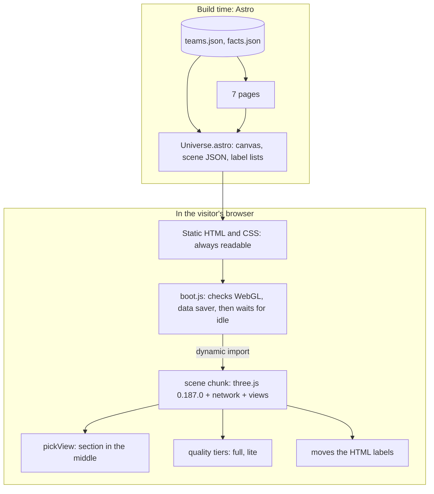
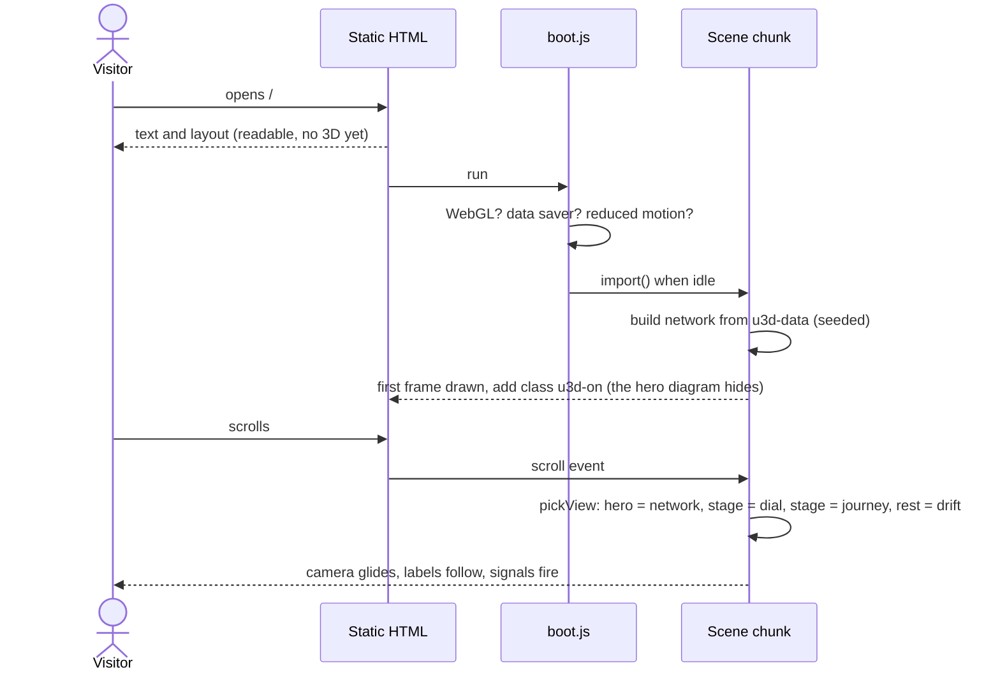

# Architecture: Personal website, 3D neural network lane

Version 1, 2026-11-27. PRD: [prd.md](prd.md) (R9 to R18, N1 to N9). Decisions: [adr/](adr/). Profile: startup.
The rest of the site (R1 to R8) is unchanged and described by its code.

## Summary
Astro still builds 7 static pages. Each page gets a `Universe` component: a fixed canvas, the scene data from
`teams.json` as JSON, and the 3D labels as real HTML lists. When the page is idle, a lazy chunk loads three.js
(ADR 0001, 0002), builds the neural network (core, 9 team hubs, 41 agent nodes, links, a background field) and
watches which section is in the middle of the screen. That section's `data-scene` view (ADR 0003) sets where the
camera goes and what the network shows. Without WebGL, or if anything fails, the page stays as dark static HTML.

## Context

## Containers

| Container | Responsibility | Technology | Scales to zero? |
|---|---|---|---|
| Pages (7) | Content, as today; sections carry `data-scene` attributes | Astro | Static |
| `Universe.astro` | Canvas, `<script type="application/json" id="u3d-data">`, the label lists for the stages | Astro component | Static |
| `boot.js` | Small, not lazy: decides whether to start, starts after idle, adds `u3d-on` to `<html>` only when the scene draws its first frame | Plain JS, about 2 KB | n/a |
| Scene chunk | `network.js` (builds nodes and links from the data, seeded), `views.js` (registry and `pickView`), `scene.js` (render loop, camera, tiers, labels, signals) | three.js, lazy chunk | n/a |
| Tests and CI | `node --test` units, Playwright browser checks, axe, Lighthouse CI, the copy gate | GitHub Actions | Runs per push |

## Key flows

### A visitor scrolls the home page

### Failure path: no WebGL, a failed chunk, or a slow phone
1. `boot.js` finds no WebGL context, or the data saver: it never loads the chunk. The page stays as static HTML,
   the hero diagram stays visible, and the stage label lists show as plain lists in their cards (R17).
2. The chunk fails to load, or throws while building: `boot.js` catches it, does not add `u3d-on`, and the page is
   the same as in step 1.
3. The frame rate stays under 30 for 2 seconds: switch to lite. Still under 30 on lite for 4 more seconds: stop the
   loop, remove the canvas and `u3d-on`; the page is the same as in step 1 (ADR 0006).
4. The browser loses the WebGL context (`webglcontextlost`): the same as step 3.

## Data model

| Entity | Fields | Relationships | Owner |
|---|---|---|---|
| SceneData (`u3d-data`) | `version: 1`, `teams[]`, `journey[]`, `seed` | built from `teams.json` at build time | `Universe.astro` |
| Team | `id` (slug of the name), `name`, `when` (formatted by `shift()`), `crew` (count), `hour` (decimal, or `null` when not daily) | has `crew` agent nodes | `teams.json` |
| JourneyStep | `id`, `name`, `detail`, `kind` (`step` or `platform`) | clock, team, critic, LinkedIn, then X, Bluesky, Facebook, Dev.to | `Universe.astro` (the same steps the home page already states) |
| Node (runtime) | `kind` (core, hub, agent, field, step), `team id`, position in each view | links to its hub; hubs to the core; field nodes to their nearest neighbours | `network.js` |
| View | `name`, camera position and target, side offset, `dial` (0 to 1), `journey` (0 to 1), opacity | chosen per section | `views.js` |

## Interfaces

| Interface | Type | Contract | Consumers |
|---|---|---|---|
| `data-scene` | HTML attribute | `network`, `dial`, `journey`, `drift`; any other value is `drift`; an element without it is `drift` | Page authors, `pickView` |
| `data-scene-labels` | HTML attribute | Shows that section's label list positioned in 3D | Stage sections |
| `data-scene-quiet` | HTML attribute | Scene opacity × 0.4 | Dense sections (workforce cards, architecture, notebook) |
| Label list | HTML | `<ol class="u3d-labels" data-for="dial|journey">` with `<li data-anchor="team:<id>|hour:<0,6,12,18>|step:<id>">` holding `<b>` name and `` detail | Scene positions them; the copy gate reads them; screen readers read them |
| `u3d-data` | JSON in a script tag | `{ "version": 1, "seed": 2026, "teams": [Team], "journey": [JourneyStep] }` | `boot.js`, the scene, unit tests |
| `pickView(rects, viewportHeight)` | Pure function | Takes `{top, bottom, scene, labels, quiet}` per section; returns the view of the section that contains the middle line, else `drift` | Scene, unit tests |
| `?u3d=debug` | URL query | Shows the frame rate, the tier and the current view; also used by Playwright to read the state | Tests, the owner |
| `html.u3d-on` | CSS class | Present only after the first frame; `.u3d-hide` elements hide only then | CSS |

## Security
- Secrets: none added. Cloudflare's token stays in GitHub secrets, as today.
- Auth: none; a public static site.
- Data: no personal data; no new third-party requests (N3); three.js keeps its licence header in the chunk.

## Screens

Dark only (R16). Every page is public; there are no roles and no refusals.

| Screen | Route | Heading | Views by section | Key controls |
|---|---|---|---|---|
| Home | `/` | A digital workforce that runs itself | hero `network`; new stage `dial` + labels; new stage `journey` + labels (tall, scroll-driven); the rest `drift` | See how it works, Get in touch |
| Workforce | `/workforce` | Nobody here takes a day off | page hero `network`; team cards `dial` quiet | Team anchors |
| Architecture | `/architecture` | How the workforce runs itself | hero `network`; the five diagram sections `journey` quiet | - |
| Growth | `/growth` | The numbers, straight from LinkedIn | hero `network`; the rest `drift` | - |
| Lab notebook | `/notebook` | What we found, entry by entry | hero `network`; entries `drift` quiet | Month anchors |
| Work | `/work` | 50 repositories. One builder. | hero `network`; the rest `drift` | Repository links |
| About | `/about` | From a farming village to a digital workforce | hero `network`; the rest `drift` | - |

Mockup: to be agreed with the owner before the gate (see STATE). Browser tests load this table from
`site/tests/screens.json`, written in the first build task.

## Compliance
No law beyond the usual for a personal site; no cookies, no tracking, no personal data.

## Cost

| Part | Expected monthly cost | Free tier used |
|---|---|---|
| Cloudflare Pages | Rs 0 | Free plan, as today |
| GitHub Actions (tests, Lighthouse) | Rs 0 | Public repository |
| **Total** | **Rs 0** | |

Spending cap: not applicable, nothing is billed. At ten times the visitors the cost stays Rs 0 (static files).

## Failure modes

| Failure | Detection | Recovery |
|---|---|---|
| No WebGL or the data saver | `boot.js` checks before loading | Static page, the chunk never loads (R17) |
| The chunk fails to load or throws | `import()` rejects, or an error during build | Static page; nothing half-drawn, because `u3d-on` comes only after the first frame |
| Slow device | Frame time over 33 ms for 2 seconds | Lite tier, then stop and fall back (ADR 0006) |
| WebGL context lost | `webglcontextlost` event | Stop and fall back |
| A section with an unknown view | `pickView` | `drift`; a warning in debug mode |
| A team added or removed in `teams.json` | Build | The scene and the labels follow automatically; a unit test checks counts match |
| A label off screen or behind the camera | Projection check | Hidden for that frame |
| A label text breaks a copy rule | The copy gate on the build | The build fails before deploy |
| The analytics agents' commit after the merge | `deploy-cloudflare.yml` | Same gates as today; no 3D-specific step can block it except a broken build |

## Traceability

| Requirement | Satisfied by |
|---|---|
| R9 | `network.js` from `u3d-data` (ADR 0001); unit test of counts |
| R10 | `views.js`, `pickView`, data attributes (ADR 0003); a views guide `site/src/lib/scene/README.md` |
| R11 | `scene.js` signals; off under reduced motion |
| R12 | Home page stage sections and the `dial` and `journey` views |
| R13 | Label lists in HTML (ADR 0004) and the copy gate |
| R14 | `boot.js` idle start; lazy chunk on our domain (ADR 0002) |
| R15 | `scene.js` still frames per scroll step under reduced motion |
| R16 | Dark tokens on `<html>`; frosted cards; axe contrast check (ADR 0005) |
| R17 | `boot.js` and the failure path; Playwright with WebGL off |
| R18 | `data-scene-quiet` on dense sections |
| N1, N9 | Cost table |
| N2 | Failure path; the deploy workflow unchanged |
| N3 | No third-party requests (Playwright network log) |
| N4 | ADR 0006 tiers; Lighthouse CI; frame rate in debug mode |
| N5 | Lane branch, preview, backup tag, revert |
| N6 | The copy gate unchanged and blocking |
| N7, N8 | Not needed (PRD) |
