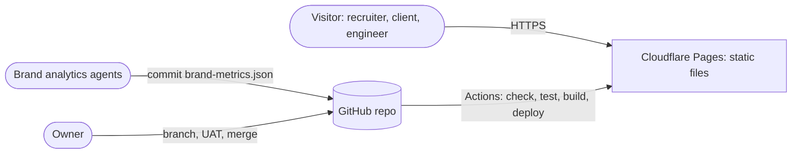
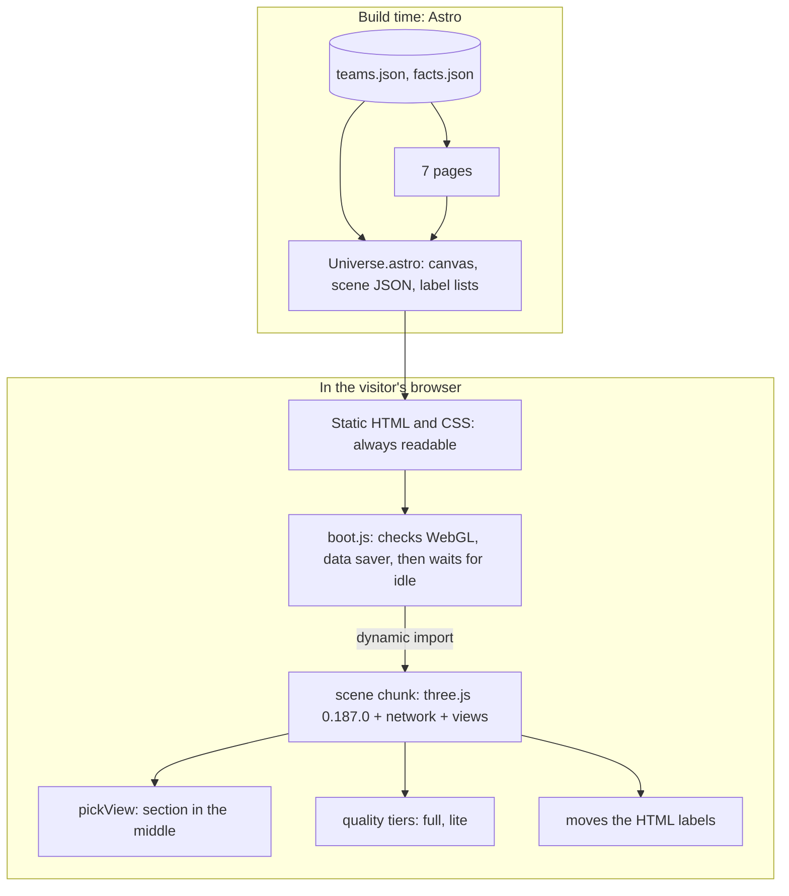

# Architecture: Personal website, 3D neural network lane

Version 1, 2026-11-27. PRD: [prd.md](prd.md) (R9 to R18, N1 to N9). Decisions: [adr/](adr/). Profile: startup.
The rest of the site (R1 to R8) is unchanged and described by its code.

## Summary
Astro still builds 7 static pages. Each page gets a `Universe` component: a fixed canvas, the scene data from
`teams.json` as JSON, and the 3D labels as real HTML lists. When the page is idle, a lazy chunk loads three.js
(ADR 0001, 0002), builds the neural network (core, 9 team hubs, 41 agent nodes, links, a background field) and
watches which section is in the middle of the screen. That section's `data-scene` view (ADR 0003) sets where the
camera goes and what the network shows. Without WebGL, or if anything fails, the page stays as dark static HTML.

## Context

## Containers

| Container | Responsibility | Technology | Scales to zero? |
|---|---|---|---|
| Pages (7) | Content, as today; sections carry `data-scene` attributes | Astro | Static |
| `Universe.astro` | Included once in `Base.astro`: the canvas, `<script type="application/json" id="u3d-data">`, the empty label overlay, and `boot.js` | Astro component | Static |
| `StageLabels.astro` | Renders one stage's label list inside that stage's card, from the same data | Astro component | Static |
| `boot.js` | Small, not lazy (the bundled `<script>` of `Universe.astro`): decides whether to start, starts after idle, sets the state attributes on `<html>` (point 3 below) | Plain JS, at most 3 KB gzipped | n/a |
| Scene chunk | `network.js` (builds nodes and links from the data, seeded), `views.js` (registry and `pickView`), `scene.js` (render loop, camera, tiers, labels, signals) | three.js, lazy chunk | n/a |
| Tests and CI | `node --test` units, Playwright browser checks, axe, Lighthouse CI, the copy gate | GitHub Actions | Runs per push |

## Key flows

### A visitor scrolls the home page

### Failure path: no WebGL, a failed chunk, or a slow phone
1. `boot.js` finds no WebGL context, or the data saver: it never loads the chunk. The page stays as static HTML in
   the dark design, and the stage label lists show as plain lists in their cards (R17).
2. The chunk fails to load, or throws while building: `boot.js` catches it, does not add `u3d-on`, and the page is
   the same as in step 1.
3. The average frame time passes 36 ms over 2 seconds (after the first second, never while hidden): switch to lite.
   Still past it on lite for 4 more seconds: stop the loop, remove the canvas and `u3d-on`; the page is the same as in
   step 1 (ADR 0006).
4. The browser loses the WebGL context (`webglcontextlost`): the same as step 3.

## Data model

| Entity | Fields | Relationships | Owner |
|---|---|---|---|
| SceneData (`u3d-data`) | `version: 1`, `teams[]`, `journey[]`, `seed` | built from `teams.json` at build time | `Universe.astro` |
| Team | `id` (the `slug()` the home page already uses for `/workforce#` anchors, moved into `lib/format.ts`), `name`, `when` (formatted by `shift()`), `crew` (count), `hour` (decimal, or `null` when not daily) | has `crew` agent nodes | `teams.json` |
| JourneyStep | `id`, `name`, `detail`, `kind` (`step` or `platform`) | clock, team, critic, LinkedIn, then X, Bluesky, Facebook, Dev.to | `site/src/data/journey.json` (new; texts in point 7 below) |
| Node (runtime) | `kind` (core, hub, agent, field, step), `team id`, position in each view | links to its hub; hubs to the core; field nodes to their nearest neighbours | `network.js` |
| View | `name`, camera position and target, side offset, `dial` (0 to 1), `journey` (0 to 1), opacity | chosen per section | `views.js` |

## Interfaces

| Interface | Type | Contract | Consumers |
|---|---|---|---|
| `data-scene` | HTML attribute | `network`, `dial`, `journey`, `drift`; any other value is `drift`; an element without it is `drift` | Page authors, `pickView` |
| `data-scene-labels` | HTML attribute | Shows that section's label list positioned in 3D | Stage sections |
| `data-scene-quiet` | HTML attribute | Scene opacity × 0.4 | Dense sections (workforce cards, architecture, notebook) |
| Label list | HTML | `<ol class="u3d-labels" data-for="dial|journey">` with `<li data-anchor="team:<id>|hour:<0,6,12,18>|step:<id>">` holding `
` and `
` (block elements, so the copy gate reads two separate lines) | Scene positions copies of them; the copy gate reads them; screen readers read them |
| `u3d-data` | JSON in a script tag | `{ "version": 1, "seed": 2026, "teams": [Team], "journey": [JourneyStep] }` | `boot.js`, the scene, unit tests |
| `pickView(rects, viewportHeight)` | Pure function | Takes `{top, bottom, scene, labels, quiet}` per section; returns the view of the section that contains the middle line, else `drift` | Scene, unit tests |
| `?u3d=debug` | URL query | Shows the frame rate, the tier and the current view on screen | The owner |
| `?u3d=test` | URL query | Pins the tier (full), turns off the automatic fallback, freezes idle motion (time stays 0), exposes `window.__u3d` | Playwright |
| `html.u3d-on` | CSS class | Present only after the first frame; sections turn see-through only then | CSS |
| `data-u3d-*` on `<html>` | HTML attributes | See point 3 below | Playwright, debug |

## Security
- Secrets: none added. Cloudflare's token stays in GitHub secrets, as today.
- Auth: none; a public static site.
- Data: no personal data; no new third-party requests (N3); three.js keeps its licence header in the chunk.

## Screens

Dark only (R16). Every page is public; there are no roles and no refusals.

| Screen | Route | Heading | Views by section | Key controls |
|---|---|---|---|---|
| Home | `/` | A digital workforce that runs itself | hero `network`; new stage `dial` + labels; new stage `journey` + labels (tall, scroll-driven); the rest `drift` | See how it works, Get in touch |
| Workforce | `/workforce` | Nobody here takes a day off | page hero `network`; team cards `dial` quiet | Team anchors |
| Architecture | `/architecture` | How the workforce runs itself | hero `network`; the five diagram sections `journey` quiet | - |
| Growth | `/growth` | The numbers, straight from LinkedIn | hero `network`; the rest `drift` | - |
| Lab notebook | `/notebook` | What we found, entry by entry | hero `network`; entries `drift` quiet | Month anchors |
| Work | `/work` | 50 repositories. One builder. | hero `network`; the rest `drift` | Repository links |
| About | `/about` | From a farming village to a digital workforce | hero `network`; the rest `drift` | - |

Mockup: https://claude.ai/artifact/8Cz9QBJRagk74imGRMJk7i, agreed by the owner on 2026-11-27 ("that should be fine"); the real build keeps the home hero diagram (point 5) and fills the labels from the data. Browser tests load this table from
`site/tests/screens.json`, written in the first build task.

## Compliance
No law beyond the usual for a personal site; no cookies, no tracking, no personal data.

## Cost

| Part | Expected monthly cost | Free tier used |
|---|---|---|
| Cloudflare Pages | Rs 0 | Free plan, as today |
| GitHub Actions (tests, Lighthouse) | Rs 0 | Public repository |
| **Total** | **Rs 0** | |

Spending cap: not applicable, nothing is billed. At ten times the visitors the cost stays Rs 0 (static files).

## Failure modes

| Failure | Detection | Recovery |
|---|---|---|
| No WebGL or the data saver | `boot.js` checks before loading | Static page, the chunk never loads (R17) |
| The chunk fails to load or throws | `import()` rejects, or an error during build | Static page; nothing half-drawn, because `u3d-on` comes only after the first frame |
| Slow device | Average frame time over 36 ms for 2 seconds (ADR 0006) | Lite tier, then stop and fall back (ADR 0006) |
| WebGL context lost | `webglcontextlost` event | Stop and fall back |
| A section with an unknown view | `pickView` | `drift`; a warning in debug mode |
| A team added or removed in `teams.json` | Build | The scene and the labels follow automatically; a unit test checks counts match |
| A label off screen or behind the camera | Projection check | Hidden for that frame |
| A label text breaks a copy rule | The copy gate on the build | The build fails before deploy |
| The analytics agents' commit after the merge | `deploy-cloudflare.yml` | Same gates as today; no 3D-specific step can block it except a broken build |

## Traceability

| Requirement | Satisfied by |
|---|---|
| R9 | `network.js` from `u3d-data` (ADR 0001); unit test of counts |
| R10 | `views.js`, `pickView`, data attributes (ADR 0003); a views guide `site/src/lib/scene/README.md` |
| R11 | `scene.js` signals; off under reduced motion |
| R12 | Home page stage sections and the `dial` and `journey` views |
| R13 | Label lists in HTML (ADR 0004) and the copy gate |
| R14 | `boot.js` idle start; lazy chunk on our domain (ADR 0002) |
| R15 | `scene.js` still frames per scroll step under reduced motion |
| R16 | Dark tokens on `<html>`; frosted cards; axe contrast check (ADR 0005) |
| R17 | `boot.js` and the failure path; Playwright with WebGL off |
| R18 | `data-scene-quiet` on dense sections |
| N1, N9 | Cost table |
| N2 | Failure path; the deploy workflow unchanged |
| N3 | No third-party requests (Playwright network log) |
| N4 | ADR 0006 tiers; Lighthouse CI; frame rate in debug mode |
| N5 | Lane branch, preview, backup tag, revert |
| N6 | The copy gate unchanged and blocking |
| N7, N8 | Not needed (PRD) |

## Implementation decisions (answers to the cold read, 2026-11-27)

A fresh agent read the PRD, this document and the ADRs, and listed 20 places where a builder would have to guess.
The answers:

1. **Data saver means no 3D**, as R17 says; ADR 0006 is corrected.
2. **CI browsers have no graphics card.** Playwright starts Chromium with `--use-angle=swiftshader --enable-unsafe-swiftshader`
   and opens pages with `?u3d=test`, which pins the tier, turns off the automatic fallback and freezes idle motion,
   so screenshots match on every run. The fallback itself is tested with `--disable-webgl`, and with a scene chunk
   request that answers 500.
3. **State the tests can read,** on `<html>`: `data-u3d-state` (`idle`, `loading`, `on`, `fallback`, `off`), `data-u3d-view`,
   `data-u3d-tier` (`full`, `lite`), and in debug and test mode `data-u3d-fps`. In test mode `window.__u3d` holds
   `{ data, view, tier, progress }`. Modes in Playwright: JavaScript off with `javaScriptEnabled: false`; WebGL off with
   `--disable-webgl`; reduced motion with `reducedMotion: "reduce"`; the data saver with an `addInitScript` that defines
   `navigator.connection.saveData = true`.
4. **Colours and layers.** `Base.astro` sets `data-theme="dark"` on `<html>` for every visitor, so the existing dark tokens
   apply (the light values stay in the file, unused). Two new tokens: `--glass: rgba(20, 32, 52, .78)` for cards and
   `--veil: rgba(12, 20, 34, .5)` for night bands. Only under `html.u3d-on` do `body`, `--paper` sections and `.night`
   bands turn see-through (cards use `--glass` with a 10px blur); in every fallback the page keeps today's opaque dark
   design. Layers: canvas `z-index: -1`, label overlay `1`, `main` and `footer` `2`, header `40`.
5. **No content is hidden.** The spike hid the home hero diagram; this design does not. The diagram stays (N6, R17);
   under `u3d-on` its first background `rect` drops to `fill-opacity: .55`, so the network glows behind it.
6. **Where the labels live:** `StageLabels.astro`, inside each stage card, renders the list (the copy gate and screen
   readers see it there). When the scene starts, it copies each `<li>` into the fixed overlay and makes the original
   list visually hidden (`html.u3d-on .u3d-labels` is `sr-only`, still read by screen readers). `Universe.astro` is in
   `Base.astro`, so every page has the scene with no code of its own (R10).
7. **Every label text** (shown in the mockup for the owner's review):
   - Teams: the name, then `shift()` of its schedule ("Daily, 8:00 AM IST", "Mondays and Thursdays", "Sundays",
     "After every post", "On call").
   - Hours: "Midnight", "6 AM", "Noon", "6 PM".
   - Journey: Clock "Starts the team"; Agent team "Planner, scouts, writer"; Critic "Four judges"; LinkedIn
     "Published first"; then X, Bluesky, Facebook and Dev.to with no detail. "Four slots a day" is not used, because
     STATE flags it as stale.
   - Teams without a daily time sit on the outer ring, evenly spaced over the arc from 6 PM to 4 AM, in `teams.json`
     order. Their position means "not on a daily clock", never a time.
8. **Dependencies,** with exact pins: `three@0.187.0` (dependency); `@playwright/test@1.65.1`, `@axe-core/playwright@4.14.1`
   and `@lhci/cli@0.16.1` (devDependencies). The scene code is plain JavaScript modules, so `@types/three` is not needed
   for `astro check`. On Windows the builder installs with `npm install --save-exact`, then checks that the lock diff
   only adds these packages and their own dependencies (no optional platform bindings removed); CI's `npm ci` on Linux
   is the proof.
9. **CI wiring,** in `site-check.yml` after the build: `node --test site/tests/unit`; the Playwright browser install with
   its cache; `npx playwright test` with `site/playwright.config.mjs` (tests in `site/tests/e2e`, `webServer` is
   `npx astro preview --port 8799`); `npx lhci autorun` with `site/lighthouserc.json`, whose N4 assertions **warn**
   while N4 is proposed and become errors once the owner confirms the numbers; then the preview deploy.
   `deploy-cloudflare.yml` stays unchanged (N2). `site/tests/screens.json` is
   `[{ "route", "heading", "sections": [{ "selector", "view", "labels", "quiet" }] }]`.
10. **First frame** means the first `render()`, one more animation frame, and the labels placed. Until then the canvas
    is at `opacity: 0`; then it fades in over 0.6 seconds (no fade with reduced motion).
11. **Idle:** `requestIdleCallback` with a 2-second timeout, or `setTimeout` 300 ms after `load` where it is missing
    (Safari). A size check in CI fails when `boot.js` passes 3 KB or the scene chunk passes 180 KB gzipped.
12. **`pickView(sections, viewportHeight)`** takes `[{ top, bottom, view, labels, quiet }]` and returns
    `{ view, labels, quiet, progress }`. The section that contains the middle line (`top <= mid < bottom`) wins; when
    sections nest, the innermost (the shortest) wins. `progress` is `clamp((0.75 * viewportHeight - top) / (0.8 * height), 0, 1)`
    and drives the journey; the journey stage is 170% of the screen tall, with a sticky card.
13. **Reduced motion:** the camera jumps to each view (no easing), there are no idle signals and no rotation, and the
    journey pulse is drawn at the scroll position.
14. **Phones** (under 900px wide): no side offset; the camera moves back to fit; dial labels show team names only, hour
    labels are hidden, and journey labels show names only. Screenshots are taken at 1280×800 and 390×844.
15. **Counts are never typed into tests:** one test checks that the scene data equals what it derives from `teams.json`,
    and a second that this equals `facts.json` (`workforce.teams`, `workforce.agents`).
16. **Slow phones:** see ADR 0006 (36 ms average over 2 seconds, after the first second, never while hidden). Because
    nothing is hidden (point 5), a fallback mid-visit only turns sections opaque again, with no layout shift.
17. **Fonts:** Google Fonts already load from `Base.astro`; they are the only allowed outside requests (N3, R14). The
    network check allows `fonts.googleapis.com` and `fonts.gstatic.com` and fails on anything else.
18. **Slugs:** one `slug()` in `lib/format.ts`, used by the home page, the workforce page and the scene data.
19. **Quiet sections:** one attribute on a wrapper: the workforce team list wrapper, each of the 5 `.arch` sections, and
    the notebook entries wrapper. `screens.json` names these selectors.
20. **Licence:** a test checks that the scene chunk contains "SPDX-License-Identifier: MIT"; if minification strips it,
    the builder sets the bundler's legal-comments option to keep it.
